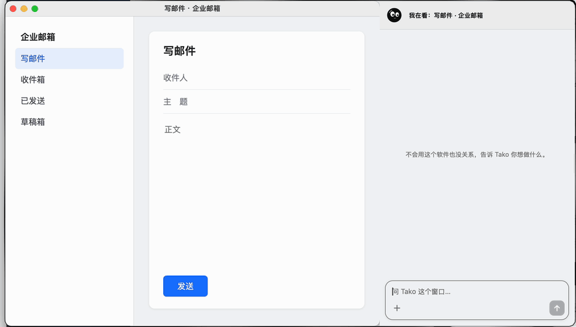

<p align="center">
  
</p>

<h1 align="center">Tako</h1>

<h3 align="center">黏在哪里，哪里就有了智能。</h3>

<p align="center">Mac 上的黏人智能体。把它拖到任何窗口上：它看得见这个窗口，也会替你操作。<br>不用切到聊天框，不用复述屏幕，也不用先学会这个软件。</p>

<p align="center">
  <a href="#安装"><strong>安装 Tako →</strong></a>　·　
  <a href="#你的电脑还是你说了算">它能碰什么</a>　·　
  <a href="CHANGELOG.md">更新日志</a>
</p>

<p align="center"><sub>Apple 芯片 · macOS 14+ · 用你自己的 ChatGPT 账号 · MIT 开源</sub></p>

<p align="center">
  
</p>
<p align="center"><sub>实录，已加速。Tako 看窗口、填收件人和正文，然后停下来。页面是演示用的测试网页。</sub></p>

## 说一句，它在窗口里动手

你在填表、回邮件，或者打开了一个没用过的软件。一般的 AI 只能在另一个窗口里教你怎么做；Tako 就在这个窗口旁边，直接做。按 **⌃⌥T**，它跳到你正在用的窗口；说一句要什么，它自己去看、去点、去填。

不会用这个软件也没关系。你说要什么，不用先知道按钮在哪。

## 找不到的东西，它圈给你看

<p align="center">
  
</p>
<p align="center"><sub>实录，已加速。问“这自动续费到底在哪关”，它翻到页底，把灰色小字圈出来。页面是演示用的测试网页。</sub></p>

## 发送键，还是你来按

Tako 可以把话写好、填进输入框，但不会替你发出去。这不是一条写给模型的约定，是系统里的硬规则：点“发送”按钮、聊天软件里按回车、⌘回车、邮件脚本的 send，都会被拒绝，你批准也不行。

| 事情 | Tako 怎么做 |
| --- | --- |
| 发消息、发邮件 | 只填不发，永远由你按 |
| 删除、支付、下单、发布 | 先弹卡片问你，不批就停 |
| 系统设置、钥匙串、终端、网络代理工具 | 每一步都问 |
| 密码框 | 不输入 |
| 你动了鼠标或切走窗口 | 立刻停 |

## 它不只是工具，还是只章鱼

<p align="center">
  
</p>

平时它蹲在屏幕上：打瞌睡，偷偷伸触手够你的光标，被发现了就缩回去装无辜。连戳它会喷墨逃跑，晃太狠会晕。它不说俏皮话，只靠动作和眼神。

## 它能帮你做的事

- **任何窗口都能问。** 网页、文档、后台系统、设计软件，它看得见你看到的东西。
- **跨窗口做事。** 在这个窗口说的话，可以让它去另一个窗口办；所有窗口共用一个大脑。
- **用脚本接口操作 Office、iWork、Mail、Safari、Chrome、备忘录、日历、提醒事项**，比点按钮更快更准。
- **改 WPS 文件。** 它先改副本，你点“应用”才替换原文件，原文件自动备份。
- **陪你听课。** 只听这个窗口的声音，在本机转成文字、记要点，课后做成笔记或脑图。声音不留、不上传（需要先装 [Whisper](https://github.com/openai/whisper)）。
- **把文件拖给它**，文件就成了这一轮的材料。

## 安装

打开“终端”，粘贴这一行，回车：

```bash
curl -fsSL https://raw.githubusercontent.com/JoeSangAI/Tako/main/install.sh | bash
```

大约一分钟。第一次打开，Tako 只会带你走这三步：

1. **给权限。** 系统会问“辅助功能”和“屏幕录制”，打开后 Tako 才能看见和操作窗口。
2. **装上 Codex、登录 ChatGPT。** 面板里按一下按钮就行。Tako 的大脑是 OpenAI 的 [Codex](https://github.com/openai/codex)，用的是你自己的 ChatGPT 账号和额度。
3. **按 ⌃⌥T。** 或者把小章鱼拖到任意窗口上松手。

> 为什么用终端安装：Tako 还没有做 Apple 公证，直接下载的 app 会被系统拦下。安装脚本会校验文件哈希和签名，你也可以先[读一遍脚本](install.sh)。

## 新版本，一键换上

有新版本时，你会收到一条系统通知，Dock 图标上有角标。打开面板能看到新版本多了什么，按“更新并重启”就换好了，权限和设置都不用重来。也可以右键小章鱼选“检查更新”。

<!-- update-shot -->

Tako 每 6 小时向 GitHub 问一次有没有新版本，只取一个版本文件，不发送你的任何信息。新版本的签名必须和你正在用的版本一致，否则不会安装。

## 你的电脑还是你说了算

- **本地优先。** Tako 自己没有服务器，也不收集数据。运行记录都在 `~/Library/Application Support/Tako/`。
- **发给模型的内容。** 你问问题时，你的话和 Tako 需要看的窗口截图、文字会经 Codex 发给 OpenAI，遵守你 ChatGPT 账号的条款。窗口截图只在它需要看时才发，本机不落盘。
- **别人说的话不算数。** 窗口、网页、文件和聊天里的内容只是材料，不是指令，只有你在面板里说的话才能让它动手。
- **钉钉窗口不碰。** 目前 Tako 不会黏上钉钉，也不会操作它。

更多见[隐私说明](docs/PRIVACY.md)。

## 现在还做不到

- 只支持 Apple 芯片的 Mac。在 macOS 15 上实测过，macOS 14 能安装但没有实测。
- **微信：** 能看当前对话、把草稿填进输入框，不发送。Tako 不解密微信聊天库，所以默认读不到屏幕之外的消息，也不会在来新消息时主动开口。
- 原生全屏的窗口里可能看不到小章鱼，按 ⌃⌥T 照常打开。
- 模型会犯错。动手前它会先看窗口，填好的东西请你过目再发。

## 给想动手的人

Tako 是 Swift + Python 写的原生 app，模型通过本机的 `codex app-server` 连接。

```bash
git clone https://github.com/JoeSangAI/Tako.git
```

```bash
cd Tako && ./run.sh
```

需要 Xcode Command Line Tools。[高级设置](docs/CONFIG.md)可以告诉 Tako 怎么称呼你、你的背景、用哪个模型，还能接入本地资料库。发现问题请[提 Issue](https://github.com/JoeSangAI/Tako/issues)。

## 现在就试试

```bash
curl -fsSL https://raw.githubusercontent.com/JoeSangAI/Tako/main/install.sh | bash
```

<sub>[MIT License](LICENSE) · Tako 是独立项目，与 OpenAI、腾讯、Apple 没有关联。</sub>
